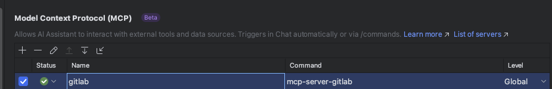

# AI MCP

MCP Server 是一個套件，提供給IntelliJ安裝使用，透過該套件可以提供AI知道怎麼操作您的intelliJ，其中MCP設定如下：

<pre><code><strong>這邊是MAC的設定。
</strong><strong>{
</strong>    "servers": {
        "jetbrains": {
            "command": "/Users/user_name/.nvm/versions/node/v18.12.0/bin/npx",
            "args": [
                "-y",
                "@jetbrains/mcp-proxy"
            ],
            "env": {
                "LOG_ENABLED": "true",
                "PATH": "/Users/user_name/.nvm/versions/node/v18.12.0/bin:/usr/local/bin:/usr/bin:/bin",
                "NODE_PATH": "/Users/user_name/.nvm/versions/node/v18.12.0/lib/node_modules"
            }
        }
    }
}

</code></pre>

要特別注意是不是有透過nvm安裝多個node 版本，如果有的話，要向上方的撰寫指令方式，指定特定的版本npx。

### 排障

另外如果單獨執行'npx -y @jetbrains/mcp-proxy' 卡住，可能是因為沒有權限異動該資料夾，需要添加sudo 指令，該指令是起動一個服務器，讓AI知道怎麼操作您的intelliJ，如果有成功啟動，可以透過[http://127.0.0.1:63342/api/mcp/list\_tools](http://127.0.0.1:63342/api/mcp/list_tools) ，確認是不是真的有順利啟動。

執行成功與否可以查看每個 'Setting>各個AI MCP頁籤' 設定好上面的json後，也確定有啟動@jetbrains/mcp-proxy ，就會看到他的狀態為已連線，可以查到所有的intelliJ工具指令；如果是一直轉，沒有成功連線，代表其中啟動@jetbrains/mcp-proxy 有問題，可以檢查一下npm 的log 一般來說是在這個位置下 '/Users/user\_name/.npm/\_logs'

## Jetbrains AI Assistant MCP設定

注意目前這個的MCP設定只支援STDIO 模式。

詳細的安裝說明使用網頁：[https://www.jetbrains.com/help/ai-assistant/mcp.html](https://www.jetbrains.com/help/ai-assistant/mcp.html)

比較特殊的地方是，當你使用NVM安裝多個版本的node時，你會需要先將套件安裝好，獨立成專用的指令，而不是透過NPX -y 即時的安裝與呼叫。

更多的mcp工具可以在這邊取得：[https://github.com/modelcontextprotocol/servers](https://github.com/modelcontextprotocol/servers)

上述網站主要都是透過npx來執行mcp Serve 但就是會遇到多版本衝突、指令集不足等問題，建議用下方的解決方案。

下面用gitlab為案例：

<pre class="language-sh"><code class="lang-sh">// 需要先安裝好對應的套件包，已確認執行當下的環境，如果裝不了，記得加sudo。
<strong>//全域安裝：
</strong>npm i -g @modelcontextprotocol/server-gitlab  
//添加指令集：
PATH="$HOME/.nvm/versions/node/v20.19.4/bin:$PATH" "$HOME/.nvm/versions/node/v20.19.4/bin/mcp-server-gitlab"
//指令:
mcp-server-gitlab
//確認console 有出現對應啟動的相關訊息，代表這個指令安裝成功。
</code></pre>

接續要在AI Assistant MCP設定區塊設定為下列模式：

```json
// MCPServer Config
{
  "mcpServers": {
    "gitlab": {
      "command": "mcp-server-gitlab",
      "args": [
        ""
      ],
      "env": {
        "GITLAB_API_URL": "https://scmg.test.com.tw/api/v4",
        "GITLAB_PERSONAL_ACCESS_TOKEN": "XXXXXXXXX",
        "GITLAB_READ_ONLY_MODE": "false",
        "LOG_ENABLED": "true",
        "STDIO": "true",
        "NODE_TLS_REJECT_UNAUTHORIZED": "0",
        "NODE_PATH": "/Users/user-name/.nvm/versions/node/v18.12.0/lib/node_modules",
        "PATH": "/Users/user-name/.nvm/versions/node/v18.12.0/bin:/usr/local/bin:/usr/bin:/bin",
        "USE_GITLAB_WIKI": "true",
        "USE_MILESTONE": "true",
        "USE_PIPELINE": "true"
      }
    }
  }
}
```

最後檢查一下 啟動狀態，如果有異常也可以在status 欄位下看到最終的錯誤訊息：

<figure><figcaption></figcaption></figure>

這邊如果要連線每一段的執行狀態，可以參考intelliJ的log區(/Users/user-name/Library/Logs/JetBrains/IntelliJIdea2025.2)，會有專屬的mcp資料夾。

<figure><figcaption></figcaption></figure>
