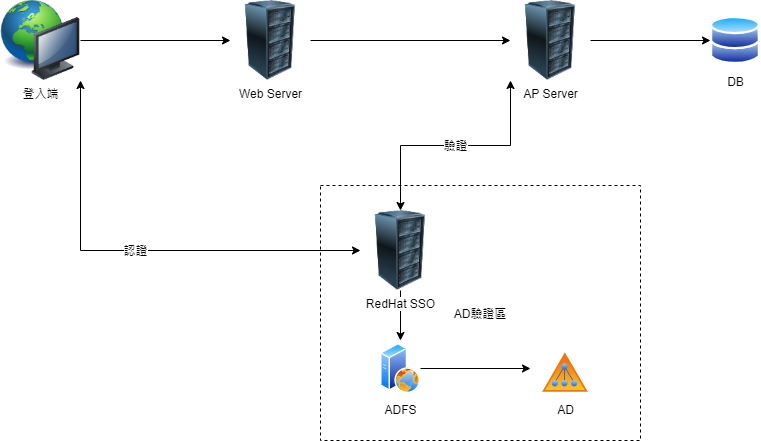

# Vue + KeyCloak + Spring Security

## 整體建置構圖



## Vue + KeyCloak

透過第三方KeyCloak套件進行Vue與KeyCloak 串接


```javascript


//
const token = localStorage.getItem('XXXOO_token')
const refreshToken = localStorage.getItem('XXXOO_refreshToken')

Vue.use(VueKeyCloak, {
  init: {
    onLoad: 'login-required',
    checkLoginIframe: false,
    token: token,
    refreshToken: refreshToken
  },
  config: {
    url: process.env.VUE_APP_KEYCLOAK_AUTH_URL,
    clientId: process.env.VUE_APP_KEYCLOAK_CLIENT_ID,
    realm: process.env.VUE_APP_KEYCLOAK_REALM
  },
  //取回後進行存取驗證內容
  onReady: (keycloak) => {
    localStorage.setItem('XXXOO_token', keycloak.token)
    localStorage.setItem('XXXOO_refreshToken', keycloak.refreshToken)
    localStorage.setItem('XXXOO_tokenParsedEmpNo', keycloak.tokenParsed.given_name)
})
```



&#x20;注意:TOKEN內容要自行塞入發送的電文header。


Restful API 發送於header 帶入 KeyCloak 取回之Token 內容。

```javascript
this.usersAxios
        .post(url, JSON.stringify(wiseRequestWrapper), {
          headers: {
            'content-type': 'application/json;charset=utf-8',
            Authorization: 'Bearer ' + localStorage.getItem('XXXOO_token')
          }
        })
```

## SpringBoot Security + KeyCloak

建立以下相關套件


```markup
<parent>
		<groupId>org.springframework.boot</groupId>
		<artifactId>spring-boot-starter-parent</artifactId>
		<version>2.2.7.RELEASE</version>
		<relativePath />
	</parent>
<!-- Key Cloak -->
		<dependency>
		    <groupId>org.keycloak</groupId>
		    <artifactId>keycloak-spring-boot-starter</artifactId>
		    <version>9.0.0</version>
		</dependency>
		<dependency>
		    <groupId>org.springframework.boot</groupId>
		    <artifactId>spring-boot-starter-security</artifactId>
		</dependency>
```



注意:SpringBoot版本使用為2.2.7。


設定相關SpringBoot Security參數


```yaml
## Authentication KeyCloak config
keycloak.auth-server-url=https://XXXXXXX.com.tw/auth ##Redhat SSO 位址
keycloak.realm=XXXXXX ##Redhat SSO 中設定
keycloak.resource=OOOO ##Redhat SSO 中設定
keycloak.enabled=true
keycloak.bearer-only=true
keycloak.ssl-required=external
keycloak.verify-token-audience=false
keycloak.use-resource-role-mappings=false
keycloak.confidential-port=0


security.cors.allowed-methods=*
security.cors.allowed-origins=*
security.ignore-all-security-check=false
security.ignore-security-check-uri-list=
```



注意: security.cors.allowed-origins 參數使用格式如: /XXX/API/\*,/API/\*


撰寫Spring Security Config with KeyCloak Adapter


```java
@KeycloakConfiguration
public class SecurityConfig extends KeycloakWebSecurityConfigurerAdapter {

	@Bean
	public GrantedAuthoritiesMapper grantedAuthoritiesMapper() {
		SimpleAuthorityMapper mapper = new SimpleAuthorityMapper();
		mapper.setConvertToUpperCase(true);
		return mapper;
	}

	/**
	 * keycloak 認證後內容篩選器/處理認證後資料
	 */
	@Autowired
	private UserPrincipalFilter userPrincipalFilter;

	/**
	 * 取得認證服務者
	 * 
	 * @return AuthenticationProvider
	 */
	@Bean
	public AuthenticationProvider authenticationProvider() {
		final KeycloakAuthenticationProvider provider = super.keycloakAuthenticationProvider();
		provider.setGrantedAuthoritiesMapper(grantedAuthoritiesMapper());
		return provider;
	}

	/**
	 * Cors configuration
	 * 需特別注意替換內容是否有錯誤，若有誤將會拋送403
	 * 
	 * @return CorsConfigurationSource
	 * @remark
	 */
	@Bean
	public CorsConfigurationSource corsConfigurationSource() {
		CorsConfiguration configuration = new CorsConfiguration();
		configuration.setAllowCredentials(true);
		configuration.addAllowedHeader("*");
		configuration.setAllowedOrigins(Arrays.asList(securityCorsAllowedOrigins));
		configuration.setAllowedMethods(Arrays.asList(corsAllowedMethods));
		UrlBasedCorsConfigurationSource source = new UrlBasedCorsConfigurationSource();
		source.registerCorsConfiguration("/**", configuration);
		return source;
	}

	@Bean
	@Override
	protected SessionAuthenticationStrategy sessionAuthenticationStrategy() {
		return new RegisterSessionAuthenticationStrategy(new SessionRegistryImpl());
	}

	/**
	 * 防止重複生成keycloak bean
	 * 
	 * @param filter
	 * @return
	 */
	@Bean
	public FilterRegistrationBean keycloakAuthenticationProcessingFilterRegistrationBean(final KeycloakAuthenticationProcessingFilter filter) {
		final FilterRegistrationBean registrationBean = new FilterRegistrationBean(filter);
		registrationBean.setEnabled(false);
		return registrationBean;
	}

	/**
	 * 防止重複生成keycloak bean
	 * 
	 * @param filter
	 * @return
	 */
	@Bean
	public FilterRegistrationBean keycloakPreAuthActionsFilterRegistrationBean(final KeycloakPreAuthActionsFilter filter) {
		final FilterRegistrationBean registrationBean = new FilterRegistrationBean(filter);
		registrationBean.setEnabled(false);
		return registrationBean;
	}

	/**
	 * 配置全域設定
	 * 
	 * @param auth
	 * @throws Exception
	 */
	@Autowired
	public void configureGlobal(AuthenticationManagerBuilder auth) throws Exception {
		//使用KeyCloak 認證
		auth.authenticationProvider(authenticationProvider());
	}

	@Override
	public void configure(WebSecurity web) throws Exception {}

	/**
	 * 設置安全控管機制
	 */
	@Override
	protected void configure(HttpSecurity http) throws Exception {
		super.configure(http);
		//資安風險須關閉
		http.csrf().disable();
		//處理X-frame-option 標頭問題
		http.headers().frameOptions().sameOrigin();
		http.headers().addHeaderWriter(new StaticHeadersWriter("Server", "Web Server"));
		//過濾API/增加認證內容確認
		http.authorizeRequests().antMatchers(HttpMethod.POST, ignoreSecurityCheckUriList)
				.permitAll().anyRequest().access("@tokenAuthentication.check(request)").and().cors()
				.and()
				.addFilterAfter(userPrincipalFilter, KeycloakAuthenticatedActionsFilter.class);

	}

}

```



注意:若有需要進行客製化憑證驗證邏輯，可參考108行，自定義檢核類別(`tokenAuthentication`)。



注意:若有需要取回憑證內容資訊，可參考110行，自定義篩選器類別(`userPrincipalFilter`)。




```java

@Component("tokenAuthentication")
public class tokenAuthentication {

		//這裡還傳入了request,我也可以使用request獲取該次請求的類型。
		public boolean check(HttpServletRequest request) {
		//如果能擷取到Principal對象不為空證明該驗證已過
		if (request.getUserPrincipal() != null) {
			return true;
		}
		return false;
	}
}

```



```java
@Component
public class UserPrincipalFilter extends OncePerRequestFilter {

	
	@Override
	protected void doFilterInternal(HttpServletRequest request, HttpServletResponse response, FilterChain filterChain) throws ServletException, IOException {
		ResettableStreamHttpServletRequest wrappedRequest = new ResettableStreamHttpServletRequest(request);

		try {
			LOGGER.info("登入IP..." + (request.getHeader("XXXXX") == null ? "127.0.0.1" : request
					.getHeader("XXXXXXX")));

			KeycloakAuthenticationToken token = (KeycloakAuthenticationToken) request
					.getUserPrincipal();
			KeycloakPrincipal<?> principal = (KeycloakPrincipal<?>) token.getPrincipal();
			AccessToken accessToken = principal.getKeycloakSecurityContext().getToken();
			LOGGER.info("登入者...." + accessToken.getGivenName());
			LOGGER.info("登入者TOKEN...." + principal);

			String rqString = IOUtils.toString(wrappedRequest.getReader());
			ObjectMapper mapper = new ObjectMapper();
			RestServiceRequest<RequestWrapper<EsunAgentDTO>> requestWrapper = mapper
					.readValue(rqString, new TypeReference<RestServiceRequest<RequestWrapper<EsunAgentDTO>>>() {});
			requestWrapper.getRequestBody().getModel().setId(accessToken.getGivenName());
			requestWrapper.getRequestBody().getModel()
					.setUserIp((request.getHeader("XXXXX") == null ? "127.0.0.1" : request
							.getHeader("XXXXX")));
			rqString = mapper.writeValueAsString(requestWrapper);

			wrappedRequest.setInputStream(IOUtils.toByteArray(rqString));
		} catch (Exception ex) {
			ex.printStackTrace();

			StringBuilder sb = new StringBuilder();
			for (String element : ExceptionUtils.getRootCauseStackTrace(ex)) {
				sb.append(element);
				sb.append("\n");
			}
			LOGGER.error("憑證驗證失敗" + sb.toString());
		}

		filterChain.doFilter(wrappedRequest, response);
	}
	
	/**
	 * 解析Request 取出 POST Body 提供修改Body的函式
	 * 
	 * 
	 */
	private static class ResettableStreamHttpServletRequest extends HttpServletRequestWrapper {

		private byte[] rawData;

		private HttpServletRequest request;

		private ResettableServletInputStream servletStream;

		public ResettableStreamHttpServletRequest(HttpServletRequest request) {
			super(request);
			this.request = request;
			this.servletStream = new ResettableServletInputStream();
		}

		public void resetInputStream() {
			servletStream.stream = new ByteArrayInputStream(rawData);
		}

		public void setInputStream(byte[] rawData) {
			servletStream.stream = new ByteArrayInputStream(rawData);
		}

		@Override
		public ServletInputStream getInputStream() throws IOException {
			if (rawData == null) {
				rawData = IOUtils.toByteArray(this.request.getReader());
				servletStream.stream = new ByteArrayInputStream(rawData);
			}
			return servletStream;
		}

		@Override
		public BufferedReader getReader() throws IOException {
			if (rawData == null) {
				rawData = IOUtils.toByteArray(this.request.getReader());
				servletStream.stream = new ByteArrayInputStream(rawData);
			}
			return new BufferedReader(new InputStreamReader(servletStream));
		}

		private class ResettableServletInputStream extends ServletInputStream {

			private InputStream stream;

			@Override
			public int read() throws IOException {
				return stream.read();
			}

			@Override
			public boolean isFinished() {
				// TODO Auto-generated method stub
				return false;
			}

			@Override
			public boolean isReady() {
				// TODO Auto-generated method stub
				return false;
			}

			@Override
			public void setReadListener(ReadListener listener) {
				// TODO Auto-generated method stub

			}
		}
	}
}
```



配置相關KeyCloak 設定檔


```java
@KeycloakConfiguration
public class KeycloakConfig {

	/**
	 * 配置Keycloak設定參數由Spring Boot設定參數檔中讀取
	 * 
	 * @return KeycloakSpringBootConfigResolver
	 */
	@Bean
	public KeycloakSpringBootConfigResolver keycloakConfigResolver() {
		return new KeycloakSpringBootConfigResolver();
	}
}

```


完成。


若遇到PKIX問題

請檢查log是否有提出連線至哪個URL憑證有誤，並將該憑證重新匯入至JDK內即可。

